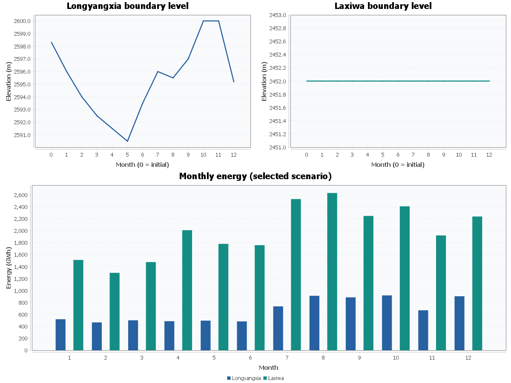

# 龙羊峡—拉西瓦 12 个月调度结果

状态：**所选离散网格内最优可行调度**。

场景：**显式修改末水位的对照场景，不能作为原参数的可行解。**

原始年末水位：龙羊峡 2600.000 m，拉西瓦 2452.000 m。当前年末水位：龙羊峡 2595.200 m，拉西瓦 2452.000 m。

| 指标 | 结果 |
| --- | ---: |
| 龙羊峡年发电量 | 79.722222 亿 kWh |
| 拉西瓦年发电量 | 238.151170 亿 kWh |
| 梯级年发电量 | 317.873392 亿 kWh（31787339.211535 MWh） |
| 最大逐库水量平衡残差 | 2.384e-07 m³ |
| 每月完整联合网格规模 | 23 × 25 |



## 数据口径与限制

365 天按平年 1—12 月分组，不宣称属于某个实际年份。zPlanLYX 按用户要求完全不参与计算。

区间来水来源模式：**input5-as-interval**。净区间年水量 236.224512 亿 m³；0 个月为负值（若有则原样保留）。

本次用户确认input5即两库之间的区间来水，直接聚合使用，拉西瓦优化入库 = 龙羊峡优化总出库 + input5月均流量。附带旧说明将input5称为入库流量，与本次指定含义不同，此差异保留以便核实。无需相减还原，不固定下库总入流，不假设区间为0。

原始单位未标注：配置显式给出库容与功率单位转换。保证出力是否作逐月硬约束由配置决定，原资料未给保证率。

月平均模型忽略月内变化、传播时滞、蒸发渗漏的单独建模和机组启停。生态约束在月平均总泄流上实施，不能证明逐日满足。未提供汛限、变幅或损失水头资料；默认正常水位上限和零损失水头。曲线以外不外推，资料不足会限制可计算转移。

- v4.xlsx 第368—369行库容不严格递增，位于本次未用水位段；原值保留。
- v4.xlsx 第519—520行库容不严格递增，位于本次未用水位段；原值保留。
- 水位库容4仅使用原表第601—702行，覆盖 2590.000000—2600.000000 m 的全部参考与运行水位；含插值邻点。
- v5.xlsx 第42—43行库容不严格递增，位于本次未用水位段；原值保留。
- v5.xlsx 第43—44行库容不严格递增，位于本次未用水位段；原值保留。
- v5.xlsx 第44—45行库容不严格递增，位于本次未用水位段；原值保留。
- v5.xlsx 第45—46行库容不严格递增，位于本次未用水位段；原值保留。
- 水位库容5仅使用原表第391—512行，覆盖 2440.000000—2452.000000 m 的全部参考与运行水位；含插值邻点。
- 按用户明确确认，input5作为两库之间的区间来水，下库入流=上库优化总出库+input5。附带旧说明称input5为入库量，与本次指定口径不同，复用资料时需核对。

## 本次有效配置

```properties
calendar.days=365
downstream.headLoss=0
downstream.levelStep=0.5
enforceGuaranteedPower=false
interval.mode=input5-as-interval
power.toMW=1
raw.directory=raw
storage.toM3=100000000
upstream.headLoss=0
upstream.levelStep=0.5
upstream.terminalLevel=2595.2
```

可追溯输入见 monthly-inputs.csv、daily-inputs.csv；原始文件与 SHA-256 清单见数据目录。详细模型见 docs/longyangxia-laxiwa-monthly.md。
